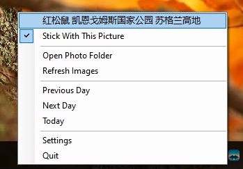

# Bing Wallpaper for Windows

A system-tray app for Windows that automatically downloads the newest
[Bing daily wallpapers](https://www.bing.com/HPImageArchive.aspx), archives
them under `Pictures\bing-wallpapers`, and sets the newest one as the
desktop wallpaper on every monitor. No more Microsoft Spotlight surprises —
you choose the picture source, the folder, and the file names.

适用于 Windows 的系统托盘应用：自动下载 Bing 每日壁纸，归档到
`图片\bing-wallpapers`，并把最新一张设为所有显示器的桌面壁纸。
告别微软 Spotlight 的不可控——图片来源、保存目录、文件名都由你说了算。

<p align="center">
  
</p>

---

## About this app / 关于这个应用

This is the Windows sibling of
[BingWallpaper-for-Mac](https://github.com/iam-otakun/BingWallpaper-for-Mac),
built to the same architecture by **Otakun** together with **Dash**, his
Muse assistant: a tray-resident app that fetches the 8 most recent Bing
archive entries, downloads only the images not yet on disk (UHD), resolves
file names from market metadata, prunes old images, and gives explicit
feedback when you refresh by hand.

这是 [BingWallpaper-for-Mac](https://github.com/iam-otakun/BingWallpaper-for-Mac)
的 Windows 姊妹版，由 **Otakun** 与他的 Muse 助手 **Dash** 按同一套架构
实现：常驻托盘，拉取 Bing 最近 8 条归档，只下载本地还没有的图（UHD），
按市场元数据生成文件名，自动清理旧图，手动刷新时明确弹窗反馈结果。

### Features / 功能

- **Daily automatic update / 每日自动更新** — Fetches on launch and every
  30 minutes whenever today's image is still missing, then sets it as the
  wallpaper. 启动时与每 30 分钟检查一次，当天图还没到就自动补上并设为壁纸。
- **Refresh with feedback / 刷新有回音** — "Refresh Images" reports its
  result: "Update successfully!" when new wallpapers arrived, "Up to date!"
  when there was nothing new, "Update failed!" if the fetch failed.
  点「Refresh Images」会弹窗报告结果：有新图「Update successfully!」，
  没有更新「Up to date!」，失败「Update failed!」。
- **Open Photo Folder / 打开照片目录** — A menu entry opens the folder
  where the wallpapers are saved. 菜单一项直达壁纸保存目录。
- **Previous / Next Day / 前一天、后一天** — Step through the downloaded
  archive from the tray menu, and jump straight back with **Today**.
  在托盘菜单里翻看已下载的归档并切换壁纸，再用「Today」一键回到今天。
- **Stick With This Picture / 钉住这张** — Fallen for one picture? Check
  this menu item and the wallpaper stays put: new photos keep downloading
  into the archive every day, they just are not set. Uncheck it and
  today's picture goes up immediately. The pinned picture is also exempt
  from the retention cleanup. The item sits at the top of the menu, right
  under the picture it pins — the toggle and its picture belong together.
  特别喜欢某张就打钩钉住：每天照常拉新图入库，只是不再更换壁纸；取消
  打钩，立刻换上今天的图。钉住的图也不会被保留期清理删掉。这一项就
  放在菜单最上方、紧贴它钉住的那张图——开关和它作用的对象在一组。
  钉住期间点 Previous Day / Next Day / Today 浏览别的天，等于松开
  钉子：Stick 自动取消打勾，壁纸与标题跟着点击一起更新——三者永远
  一致，不会出现勾还打着、状态却已经走开的局面。
- **Custom file names / 自定义文件名** — Three formats, same as the Mac
  version: English, bilingual (Chinese + English), or local language.
  Changing the format in Settings takes effect immediately: today's and
  the recent photos are renamed to the new format, the wallpaper is
  re-applied, and the menu title follows. Pressing OK in Settings
  applies the selected format even when it did not change, which also
  heals names that never matched it. Names are resolved by matching the
  photo's image key in each market's feed, never by date alone — see the
  note below. 三档文件名格式，与 Mac 版一致：英文、双语（中文+英文）、
  本地语言。在设置里改完格式点 OK 立刻生效：今天和最近的照片按新格式
  改名，壁纸重新设定，菜单标题同步更新。即使格式没变，按 OK 也会把
  所选格式应用一遍——顺带把从未匹配上格式的名字一并修复。文件名一律
  按照片的图像标识在各市场源里配对解析，绝不只按日期配对（见下方
  实测说明）。
- **Self-update / 在线更新** — The app checks GitHub Releases at most
  once a day and offers the update with a balloon; "Check for Updates…"
  in the menu checks on demand. Installing downloads the release zip,
  swaps the exe and restarts the app — no manual download, unzip and
  overwrite any more. 程序每天最多自动检查一次 GitHub 发布，有新版本
  时弹气泡提示；菜单里的「Check for Updates…」可随时手动检查。点安装
  即自动下载发布包、替换程序并重启——不必再手动下载、解压、覆盖。
- **Retention / 保留期** — Keep images 5 / 10 / 50 / 100 days, or forever.
  保留 5 / 10 / 50 / 100 天，或永久保留。
- **Launch at login / 开机自启** — Optional, via the current user's Run
  key. 可选开机自启（当前用户 Run 注册表项）。

### A note on bilingual names / 关于双语文件名的一点实测

Bing steers markets by exit IP, not only by the `mkt` parameter: from a
China exit, a request for `mkt=en-US` is answered with zh-CN metadata
anyway (verified 2026-11-24: identical `OHR.` id and Chinese copyright).
The app detects this — if the "English" keywords come back identical to
the Chinese ones, it names the file with the Chinese keywords alone
instead of duplicating them after a hyphen. On an exit where en-US
metadata is really served, full bilingual names appear as designed.

Bing 按出口 IP 分市场，不只看 `mkt` 参数：国内出口请求 `mkt=en-US`，
拿回来的仍是 zh-CN 元数据（2026-11-24 实测：`OHR.` 标识与中文版权文本
完全一致）。App 会识别这种情况——若「英文」关键词与中文相同，就只用
中文关键词命名，不再在连字符后重复一遍；在真正能拿到 en-US 元数据的
出口下，双语文件名会按设计完整出现。

Markets also run **different editorial selections**: the same date is
not the same photo everywhere (verified 2026-11-24 from a Japan exit:
2026-11-23 was the Cairngorms red squirrel in the zh-CN and ja-JP
selections, but the fiddlehead fern in en-US — and the fern was zh-CN's
2026-11-22 photo). Three consequences, all handled since 1.0.6: the
bilingual resolver matches the Chinese and English feeds independently,
so a photo that ran in only one market still gets that market's name
instead of a bare date; a format change never renames a file from a
same-date entry of another market (a different photo) — entries are
matched by image key; and a name that once fell back to a bare
`yyyyMMdd.jpg` is re-resolved and renamed on a later update.

各市场还是**各自选图**的：同一天在不同市场不是同一张照片（2026-11-24
日本出口实测：2026-11-23 在 zh-CN 与 ja-JP 是凯恩戈姆斯红松鼠，在
en-US 却是蕨菜卷叶；而蕨菜是 zh-CN 的 2026-11-22）。三条后果，1.0.6
起全部处理：双语解析把中文源与英文源独立配对，只在一个市场出现过的
照片也能拿到那个市场的名字，不再落到裸日期；改格式时绝不拿另一个
市场同日期条目（另一张照片）的名字来改名——条目按图像标识配对；
曾经落成裸名 `yyyyMMdd.jpg` 的文件，会在后续更新时重新解析并改名。

## Build / 构建

Single-file C# (C# 5, .NET Framework 4.8). No SDK, no NuGet — `csc.exe`
ships with Windows:

单文件 C#（C# 5，.NET Framework 4.8）。无需 SDK、无需 NuGet——`csc.exe`
随 Windows 自带：

```
build.cmd
```

produces `BingWallpaper.exe`. Headless verification:
`BingWallpaper.exe --selftest` runs one update cycle and writes the
result to `%AppData%\BingWallpaper\selftest.txt`.

生成 `BingWallpaper.exe`。无界面验证：`BingWallpaper.exe --selftest`
跑一个完整更新周期，结果写入 `%AppData%\BingWallpaper\selftest.txt`。

## Credits / 作者

By **Otakun** ([@iam-otakun](https://github.com/iam-otakun)) and **Dash**,
his Muse assistant — idea by Otakun, code by Dash, decisions made together.

由 **Otakun**（[@iam-otakun](https://github.com/iam-otakun)）与他的 Muse
助手 **Dash** 完成——idea 出自 Otakun，代码出自 Dash，决定一起拍板。
